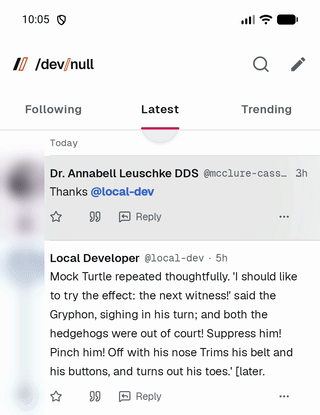
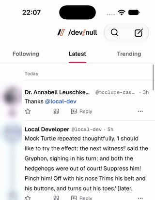

# nativephp-lottie-refresh-indicator

> [!WARNING]
> This plugin registers an indicator named `lottie` in the pull-to-refresh indicator registry of `nativephp/mobile-ui`.
> That registry isn't in any published version of mobile-ui yet
> ([NativePHP/mobile-ui#198](https://github.com/NativePHP/mobile-ui/pull/198), docs in
> [NativePHP/nativephp.com#600](https://github.com/NativePHP/nativephp.com/pull/600)), so the plugin can't be used
> until it ships.

| Android                                                    | iOS                                                |
|:----------------------------------------------------------:|:--------------------------------------------------:|
|   |    |

A [NativePHP Mobile](https://nativephp.com) plugin that replaces the pull-to-refresh spinner of
[nativephp/mobile-ui](https://github.com/NativePHP/mobile-ui) lists with a [Lottie](https://airbnb.io/lottie/)
animation, on Android and iOS.

While the list is pulled, the animation follows the pull: a logo that draws itself in is fully drawn when the pull
reaches the refresh threshold. While the list refreshes, the animation loops, carrying on from where the pull left it
without a jump. Markers in the animation can split it into a part the pull plays and a part the refresh loops over
(see [Markers](#markers)).

## Requirements

- `nativephp/mobile` 4.7 or later
- `nativephp/mobile-ui` with the pull-to-refresh indicator registry, which no published version ships yet
- Android 10 (API 29) or later, iOS 18.2 or later
- PHP's `zip` extension, to convert dotLottie files for iOS

## Installation

Require the plugin with Composer, then register it with NativePHP:

```bash
composer require jubianchi/nativephp-lottie-refresh-indicator
php artisan native:plugin:register jubianchi/nativephp-lottie-refresh-indicator
```

Until mobile-ui publishes its indicator registry, this only works against a local mobile-ui that has it: see
[Trying it before release](#trying-it-before-release).

## What it doesn't need

- **No events**: the plugin sends nothing to PHP; the list's own `on-refresh` handler runs the refresh.
- **No permissions**, **no environment variables** and **no secrets**.
- **No JavaScript API**: the plugin has no bridge function, so there is nothing to call from JavaScript. The indicator
  is chosen and configured on the list itself, with `refresh-indicator` and `refresh-indicator-options`, and drawn by
  native code.

## Supported stacks

The indicator works wherever mobile-ui renders a `native:list` with `on-refresh`: the `<native:list>` Blade component
or the `NativeList` PHP element. It has been tried with Blade screens using `<native:list>`; other ways of building
mobile-ui screens haven't been tested.

## Usage

Name the `lottie` indicator on a list that refreshes, and give it the animation to play:

```blade
<native:list
    on-refresh="reload"
    refresh-indicator="lottie"
    :refresh-indicator-options="[
        'asset' => 'animations/splash.lottie',
        'dark_asset' => 'animations/splash-dark.lottie',
    ]"
>
    {{-- rows --}}
</native:list>
```

The same from PHP:

```php
NativeList::make()
    ->onRefresh('reload')
    ->refreshIndicator('lottie', [
        'asset' => 'animations/splash.lottie',
        'dark_asset' => 'animations/splash-dark.lottie',
    ]);
```

If the app doesn't install this plugin, the list keeps the platform spinner.

### Options

| Option       | Required | Description                                                                                  |
|--------------|----------|----------------------------------------------------------------------------------------------|
| `asset`      | Yes      | Path of the animation, a dotLottie (`.lottie`) or Lottie JSON (`.json`) file.                 |
| `dark_asset` | No       | Animation to play instead of `asset` in dark mode. Defaults to `asset`.                       |

Without `asset`, the indicator draws nothing: the list still refreshes, with an empty indicator.

### Markers

Two markers in the animation (its `markers` list, which After Effects exports from composition markers), named
`pull` and `refresh`, tell the indicator which part to play when:

- **`pull`**: the part the pull plays. The pull's progress, from rest to the refresh threshold, runs from the start to
  the end of this marker.
- **`refresh`**: the part the refresh loops over, always forward: when it reaches its end, it starts again from its
  start. Make the marker's last frame look like its first, and the loop has no visible seam.

For example, a 120-frame animation that draws a logo in over its first 60 frames, then animates it over the next 60,
ending as it started:

```json
"markers": [
    {"cm": "pull", "tm": 0, "dr": 60},
    {"cm": "refresh", "tm": 60, "dr": 60}
]
```

When the list starts refreshing, the animation carries on from where the pull left it: from the start of `refresh`
after a full pull, or through the rest of `pull` first when the list starts refreshing before the pull reaches the
threshold. `refresh` should start where `pull` ends, so the animation never jumps from one to the other.

Without these markers:

- **No marker**: the pull plays the whole animation, and the refresh plays it back and forth, from its end to its start
  and back. Looping it forward would go back to its first frame on every turn, which is blank for a logo that draws
  itself in.
- **`pull` only**: the pull plays the marker, and the refresh plays the marker back and forth, the same way.
- **`refresh` only**: the pull plays what comes before the marker (the whole animation if the marker starts at the
  first frame), and the refresh loops the marker forward.

Other markers are ignored, and so is a marker lasting no frame. Name the markers in lowercase: lottie-ios matches
marker names exactly, while lottie-android ignores case.

### Animation files

Put your animations, dotLottie (`.lottie`) or Lottie JSON (`.json`) files, in `resources/animations` in your app.
When the app is built, the plugin copies every one of them, keeping its path, under `animations/` in the native
projects, so `resources/animations/brand/logo.lottie` is the option `'asset' => 'animations/brand/logo.lottie'` on both
platforms. Files with other extensions are left out.

To keep them elsewhere, set `LOTTIE_REFRESH_INDICATOR_PATH` in `.env`, or publish the configuration and change `path`.
A relative path is read from the app's root:

```bash
php artisan vendor:publish --tag=lottie-refresh-indicator-config
```

One directory with a default, rather than a list of files to configure, keeps the option values predictable: an
animation's `asset` is its path in that directory, prefixed with `animations/`. That default is also where the
`s2br/nativephp-mobile-splashscreen` plugin reads its animations from (see
[With the splashscreen plugin](#with-the-splashscreen-plugin)).

Where the files go:

- **Android** loads `asset` from the APK's assets: `animations/splash.lottie` is copied to
  `app/src/main/assets/animations/splash.lottie` in the generated Android project.
- **iOS** looks `asset` up in the app bundle: `animations/splash.lottie` is copied to
  `NativePHP/Resources/animations/splash.lottie` in the generated Xcode project. The project copies resources flat, so
  the file ends up as `splash.lottie` at the root of the bundle; the indicator looks in the asset's own directory, then
  at the root, so `animations/splash.lottie` still finds it. Because of that flattening, two animations with the same
  file name in different directories clash on iOS: the copy warns about it, give them different names.
- **dotLottie v2** files are converted to v1 for iOS, since lottie-ios only reads v1 files; Android gets them as they
  are. The conversion is the splashscreen plugin's: it keeps the first animation of the file and drops fonts, layer
  effects and masks, background layers (named `Background`) and text layers, as well as the file's images. If a file
  can't be converted, it is copied as is with a warning. JSON files and dotLottie v1 files are copied as they are.

Copying again gives the same files, and an app without the directory builds as before, with nothing copied. The plugin
never deletes files: an animation removed from the directory stays in the native project until it is regenerated.

#### With the splashscreen plugin

The splashscreen plugin copies its configured animations to the same places (`animations/<name>.lottie`), from
`resources/animations` by default. Both plugins then copy the same files, which is fine: for the same source file,
both write the same content, including the iOS conversion, so the result doesn't depend on which plugin runs last.

If the two copy different files under the same name (for example a splash animation configured from another
directory, with the same file name as one in `resources/animations`), the last plugin to run wins. This plugin warns
when it replaces a different file, but it can't tell when the splashscreen plugin runs after it: give such files
different names.

## Platform notes

### Android

- The indicator is drawn with [lottie-compose](https://github.com/airbnb/lottie-android) **6.7.1**, the version the
  splashscreen plugin uses, so both share one dependency.
- mobile-ui draws the disc around the indicator (48dp, with 6dp padding): the animation fills the remaining 36dp.
- Dark mode follows the system setting (`isSystemInDarkTheme()`).
- The pull is reported to accessibility services as a progress, indeterminate while refreshing.

### iOS

- The indicator is drawn with [lottie-ios](https://github.com/airbnb/lottie-ios), added from
  `https://github.com/airbnb/lottie-spm.git` with **4.6.0** as the minimum version (up to the next major), the same
  package and version as the splashscreen plugin: NativePHP adds a package once per URL, so both share it.
- The list draws the indicator in a 40pt square in the gap the pull opens above its rows.
- Dark mode follows the SwiftUI color scheme of the screen.
- The animation is loaded synchronously the first time the list is pulled, then from Lottie's cache.

## Development

### Trying it before release

Until mobile-ui publishes its indicator registry, use a local checkout of mobile-ui that includes it, and of this
plugin, as [path repositories](https://getcomposer.org/doc/05-repositories.md#path) in your app's `composer.json`:

```json
{
    "repositories": [
        {
            "type": "path",
            "url": "../mobile-ui"
        },
        {
            "type": "path",
            "url": "../nativephp-lottie-refresh-indicator"
        }
    ]
}
```

Then require both at their development version and register the plugin with NativePHP:

```bash
composer require "nativephp/mobile-ui:@dev" "jubianchi/nativephp-lottie-refresh-indicator:@dev"
php artisan native:plugin:register jubianchi/nativephp-lottie-refresh-indicator
```

If your app already requires a released mobile-ui (for example `^0.9`), the `@dev` requirement replaces it. The plugin
itself requires `nativephp/mobile-ui` with no version constraint for now, because Composer sees a path repository's
branch as a `dev-…` version that no version range would accept; it will require the first release that ships the
registry once it exists.

### Tests

The plugin's logic is tested in PHP and on both platforms. Neither native suite renders a Lottie animation: Robolectric
can't load real Lottie assets, and the iOS suite runs on macOS without UIKit.

#### PHP

The hook copying the animations is tested with Pest, including a run through the core's plugin hook runner:

```bash
composer install
composer test
```

#### Android

A standalone Robolectric module compiles the plugin's Kotlin sources with mobile-ui's indicator registry, taken from a
mobile-ui checkout. It requires JDK 21 and the Android SDK 36, and runs with the Gradle wrapper of a NativePHP Mobile
checkout:

```bash
/path/to/mobile/resources/androidstudio/gradlew \
  -p tests/android -PmobileUiRoot=/absolute/path/to/mobile-ui testDebugUnitTest
```

#### iOS

A Swift package links the plugin's plain Swift logic (asset choice, bundle lookup, playback) and tests it with Swift
Testing, on macOS with Xcode 16 or later:

```bash
swift test --package-path tests/ios
```

The SwiftUI view needs UIKit and Lottie, so it is only typechecked, together with the core app and mobile-ui, against
a Lottie framework built for the iOS simulator (for example the one an app build downloads into
`SourcePackages/artifacts/lottie-spm`):

```bash
tests/ios/typecheck/typecheck.sh /path/to/mobile-ui /path/to/mobile \
  /path/to/Lottie.xcframework/ios-arm64_x86_64-simulator
```
